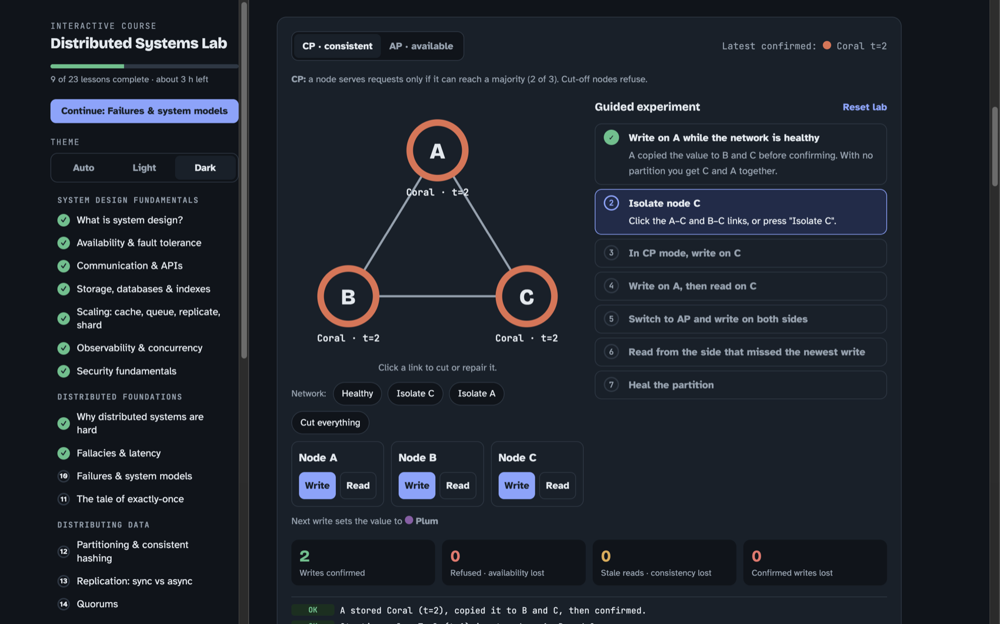
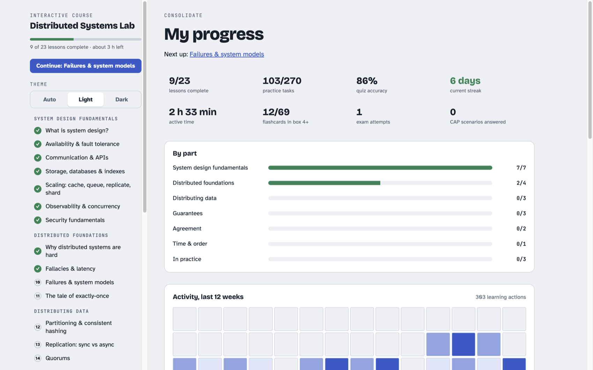
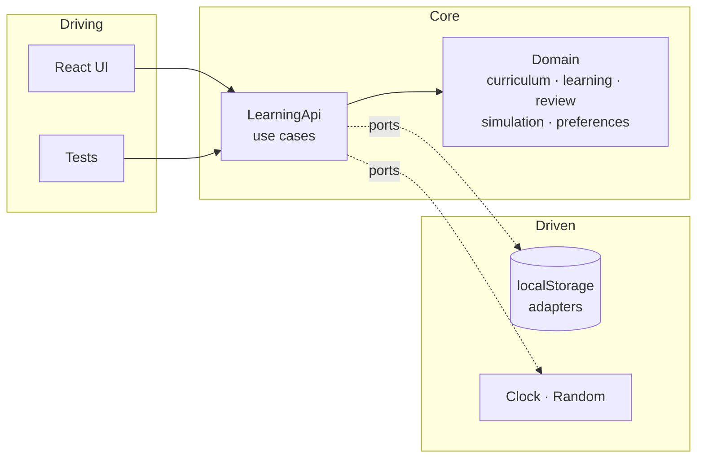

<div align="center">

# Distributed Systems Lab

**Learn system design and distributed systems by breaking things.**<br>
23 lessons, 23 interactive labs, 250 quiz questions, 270 practice tasks, and a spaced-repetition deck that makes it stick.

[**Open the live course →**](https://distributed-systems-lab.vercel.app)

<br>


<br>



</div>

<br>

## Why it's different

Most courses explain CAP, Raft and quorums with a diagram and a paragraph. Here you **cut the network yourself**, watch a leader get elected, lose a confirmed write, and then answer questions about what you just saw.

- **Predict first.** Every lesson opens with a question. Guessing before you read, even wrongly, makes the explanation stick.
- **Learn by playing.** Each lesson has a live simulation: change the quorum, partition the cluster, crash the primary.
- **Practice that checks itself.** Tasks tick off automatically when you reach the goal in the lab (for example, "find a setup where reads are consistent but writes survive one failure"), plus numeric problems with instant feedback.
- **Retrieve, don't reread.** A quiz of 10 to 14 questions per lesson, with an explanation for every answer.
- **Explain it back.** Write the idea in your own words, then compare it with a model answer.
- **Spaced repetition.** Flashcards from every lesson you open feed a Leitner-box review deck.
- **Interleaved final exam.** CAP scenarios and ten random questions drawn from the whole course.

## What you'll learn

About 5 hours of material in 23 lessons. Every lesson has hands-on exercises, and nearly all have a live simulation:

| Part | Lessons and labs |
|---|---|
| **System design fundamentals** | What is system design? *(architecture explorer)* · Availability and fault tolerance *(nines builder)* · Communication and APIs *(call-chain latency)* · Storage, databases and indexes *(quadtree search)* · Scaling *(Zipf and LRU cache simulator)* · Observability and concurrency *(tail latency, Amdahl's law)* · Security fundamentals *(CIA and threat matching)* |
| **Distributed foundations** | Why distributed systems are hard · Fallacies and latency *(latency ladder)* · Failures and system models *(failure detector)* · The tale of exactly-once *(delivery simulator)* |
| **Distributing data** | Partitioning and consistent hashing *(mod N vs ring, virtual nodes)* · Replication *(sync vs async timeline)* · Quorums *(R + W > N calculator)* |
| **Guarantees** | The CAP theorem *(partition lab with guided experiment)* · Consistency models *(linearizability histories)* · ACID and isolation levels *(anomaly explorer)* |
| **Agreement** | Distributed transactions *(2PC and sagas)* · Consensus *(Raft cluster you can crash and split)* |
| **Time and order** | Clocks, causality and vector clocks *(Lamport vs vector)* |
| **In practice** | Resilience patterns *(retries, backoff, jitter)* · Case studies *(real systems, CP or AP)* · Design framework and estimation *(back-of-envelope calculator)* |

## Track your progress



Everything you do is saved in your browser (`localStorage`). There is no account and no server.

- Lessons, practice tasks, quiz accuracy and best scores, streak, active time, flashcard mastery
- Progress by part and a 12-week activity heatmap
- **Export, import and reset** from the dashboard, so you can move between devices
- Lab settings are remembered too, so each lab looks the way you left it

## Built to be pleasant to use

- Light, dark and auto themes, with no flash on load
- Keyboard first: <kbd>[</kbd> and <kbd>]</kbd> for previous and next, <kbd>t</kbd> for theme, every lab usable without a mouse, skip link, focus moves to the new page heading
- Screen-reader friendly: labelled controls, live regions for feedback, `role="progressbar"`
- Responsive down to phone width, 44 px touch targets, reduced-motion and forced-colors support
- One self-contained HTML file when built: opens from disk, works offline

## Run it locally

```sh
npm install
npm run dev        # http://localhost:5173
npm run check      # typecheck + tests + production build
```

`npm run build` produces `dist/index.html`, a single file you can host anywhere.

## Architecture

Hexagonal architecture with DDD bounded contexts, written in a functional style. The dependency rule is checked by a test that fails the build.



| Layer | What lives there |
|---|---|
| `domain/` | Pure code: the course catalogue, the progress aggregate and its reducer, spaced repetition, one pure model per lab. No React, no storage, no libraries. |
| `application/` | The `LearningApi` use cases and the ports (`ProgressRepository`, `LabSettingsRepository`, `PreferencesRepository`, `Clock`, `Random`). |
| `infrastructure/` | Adapters: localStorage, zod schemas, JSON export and import, migration of older saves. |
| `presentation/` | React views, lesson bodies, hooks. Labs are thin views over pure models. |
| `main.tsx` | Composition root: the only place that picks adapters. |

Time and randomness are injected, so every simulation is deterministic and testable. Read more in [ARCHITECTURE.md](ARCHITECTURE.md), including how to add a lab.

## Tests

532 tests across 44 files, including:

- **Architecture rules**: layers and bounded contexts can't import each other the wrong way
- **Lab models**: the maths and simulations, with proof that every practice task is reachable
- **Content**: every lesson has at least 10 quiz questions and 8 practice tasks, and every numeric answer is checked against the model
- **Fresh start**: mounting every lesson with default settings must not complete a single task
- **Persistence**: one contract suite runs against every storage adapter

## Tech

React 19 · TypeScript (strict, `noUncheckedIndexedAccess`) · Vite · Vitest and Testing Library · zod for validating saved data · no runtime dependencies beyond React and zod.
